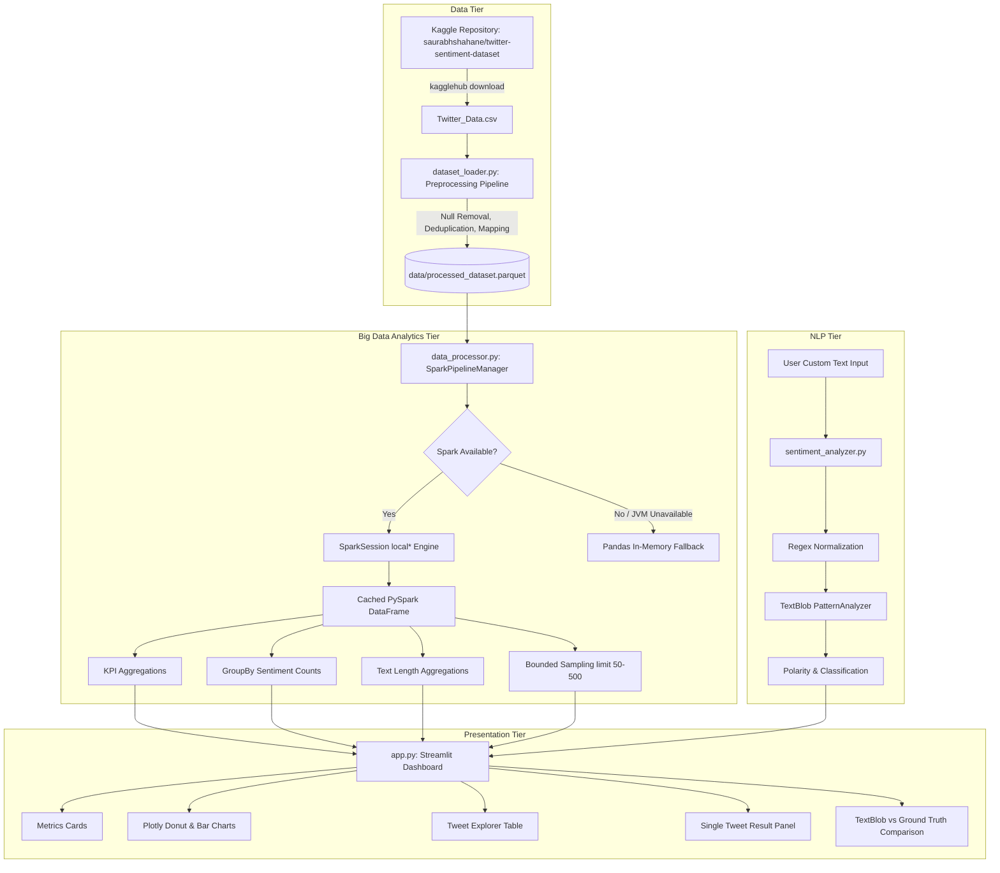
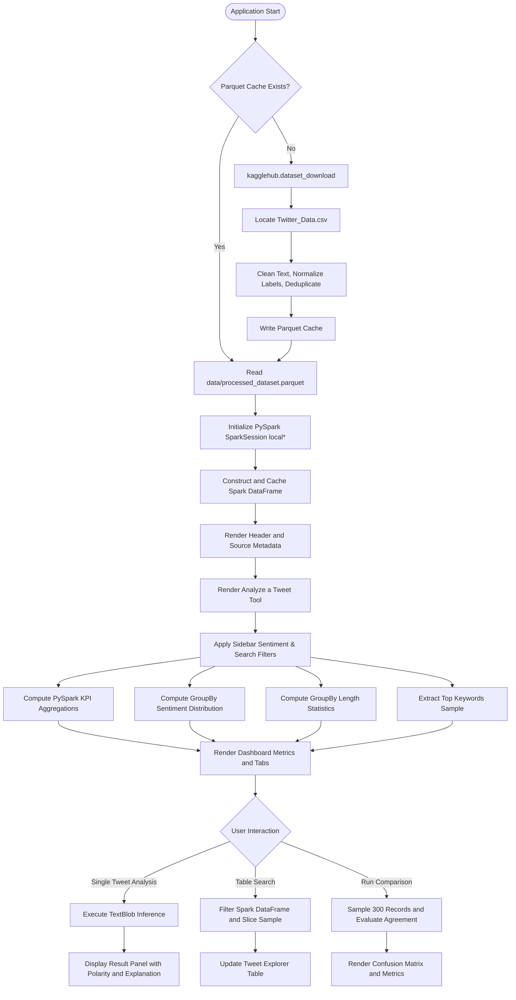

# Social Pulse: Twitter Sentiment Analytics Using Big Data Analytics
## Technical Project Documentation and Viva Handbook

---

## 1. Project Overview

Social Pulse is an end-to-end Big Data Analytics (BDA) application designed to process, classify, and visualize public sentiment across 160,000+ real social media records. Developed for an engineering Project-Based Learning (PBL) curriculum, the system integrates a real-world Kaggle Twitter sentiment dataset, provides large-scale DataFrame processing using Apache PySpark, enables on-demand individual tweet sentiment analysis using TextBlob, and presents actionable insights through a clean, Twitter/X-inspired web dashboard built with Streamlit and Plotly.

The application bridges the gap between scalable distributed computing and natural language processing by leveraging Apache PySpark for DataFrame aggregations, TextBlob for lexical polarity scoring, and Streamlit for responsive visual reporting.

### Practical Applications
* Brand Reputation Monitoring: Evaluating customer perception surrounding product features and service quality.
* Public Opinion Tracking: Assessing general societal sentiment across large-scale textual conversations.
* Operational Prioritization: Identifying recurring negative feedback patterns to direct operational interventions.
* Model Benchmarking: Comparing lexicon-based sentiment models against human-annotated ground-truth datasets.

---

## 2. Problem Statement

Microblogging platforms such as Twitter/X generate high-velocity, high-volume, and linguistically noisy textual records. Manual inspection is unfeasible at scale. Organizations require automated computational pipelines capable of:
1. Programmatically ingesting large social media corpora without relying on paid or rate-limited live platform APIs.
2. Cleaning, validating, and normalizing noisy, unformatted textual records.
3. Executing high-performance distributed aggregations, group-bys, and filtering on hundreds of thousands of records without encountering memory bottlenecks.
4. Providing real-time inference on individual, user-supplied texts with transparent mathematical explanations of predicted classifications.
5. Delivering a professional, clutter-free analytical dashboard suitable for operational analytics and academic presentation.

---

## 3. Objectives

### Primary Objectives
* Ingest the authentic Kaggle Twitter Sentiment Dataset programmatically using kagglehub without synthetic data generation.
* Construct an Apache PySpark processing pipeline to execute genuine DataFrame transformations, group-by aggregations, text length statistics, and multi-criteria filtering on 160,000+ records.
* Build an individual tweet text sentiment analysis interface allowing users to evaluate custom text inputs on demand.
* Design a modern, restrained Twitter/X-inspired analytics dashboard with zero emojis and a professional editorial visual hierarchy.

### Secondary Objectives
* Implement a resilient in-memory fallback engine (Pandas) that activates automatically if the Java Virtual Machine (JVM) or PySpark is unavailable.
* Provide Parquet caching to eliminate redundant data cleaning and downloading on application restarts.
* Perform a methodological comparison between human-annotated ground-truth labels and TextBlob lexical predictions.
* Verify pipeline correctness and reliability with an automated Pytest test suite.

---

## 4. Scope

### In Scope
* Programmatic download and extraction of `saurabhshahane/twitter-sentiment-dataset` via kagglehub.
* Ingestion, null removal, whitespace stripping, category mapping, and deduplication of 162,980 raw records into 160,843 validated records.
* PySpark DataFrame transformations (`withColumn`, `filter`, `groupBy`, `agg`, `count`, `avg`, `min`, `max`).
* Local multi-threaded PySpark execution using `master("local[*]")` with 2 GB driver memory allocation.
* Individual tweet sentiment scoring using TextBlob lexical polarity and configurable positive and negative classification thresholds.
* Streamlit user interface featuring a Twitter/X design language (white canvas `#ffffff`, dark typography `#0f1419`, subtle dividers `#eff3f4`, Twitter blue `#1d9bf0`).
* Automated test suite covering 17 test cases across all modules.

### Out of Scope
* Scraped or live authenticated Twitter/X API access (prohibited by platform subscription paywalls).
* Multi-node physical Spark cluster orchestration (runs locally on multi-threaded standalone master).
* Deep learning transformer fine-tuning (e.g. RoBERTa/BERT), which requires dedicated GPU infrastructure.
* Manufacture of artificial topic classifications or timestamps absent from the original Kaggle dataset.

---

## 5. Technology Stack

| Layer | Technology | Version | Justification |
| :--- | :--- | :--- | :--- |
| Programming Language | Python | 3.10+ | Standard language for Big Data analytics, data engineering, and machine learning. |
| Big Data Analytics | Apache PySpark | 4.2.0 | High-performance distributed DataFrame processing with Catalyst Query Optimizer. |
| Dataset Management | kagglehub | 1.0.3 | Reliable, programmatic download of Kaggle datasets with automatic local cache resolution. |
| Data Manipulation | Pandas | 3.1.0 | Fast tabular conversions, local Parquet file I/O, and fallback analytics engine. |
| Natural Language Processing | TextBlob | 0.20.1 | Rule-based lexical sentiment analysis via PatternAnalyzer, providing explainable polarity scores. |
| Dashboard Interface | Streamlit | 1.66.1 | Lightweight, reactive Python web framework for analytical dashboards. |
| Data Visualization | Plotly | 7.1.0 | Interactive charting library supporting tooltips, clean formatting, and responsive rendering. |
| Unit Testing | Pytest | 9.1.1 | Modular testing framework for asserting pipeline accuracy, schemas, and edge-case resilience. |

---

## 6. Dataset Source and Kagglehub Integration

The application utilizes an authentic, widely cited social media sentiment corpus:
* **Kaggle Dataset**: `saurabhshahane/twitter-sentiment-dataset`
* **Source URL**: `https://www.kaggle.com/datasets/saurabhshahane/twitter-sentiment-dataset`
* **Access Method**: Programmatic ingestion via `kagglehub.dataset_download()`

### Download Logic
The dedicated `dataset_loader.py` module executes the following programmatic retrieval:
```python
import kagglehub

download_path = kagglehub.dataset_download("saurabhshahane/twitter-sentiment-dataset")
```
The loader dynamically searches the target directory tree for the primary dataset CSV (`Twitter_Data.csv`) without relying on hardcoded system paths.

### Authentication Details
The `saurabhshahane/twitter-sentiment-dataset` is a public Kaggle dataset and does not require explicit credentials for download. If accessing private datasets, kagglehub automatically reads credentials from `~/.kaggle/kaggle.json` or the environment variables `KAGGLE_USERNAME` and `KAGGLE_KEY`.

---

## 7. Dataset Schema and Actual Sentiment Labels

The raw dataset contains 162,980 rows across two primary fields:

| Column Name | Raw Data Type | Content Description | Sample Value |
| :--- | :--- | :--- | :--- |
| `clean_text` | String | Raw tweet text content | `"when modi promised minimum government maximum governance..."` |
| `category` | Float / Numeric | Ground-truth sentiment annotation code | `-1.0`, `0.0`, `1.0` |

### Label Interpretation
Through inspection of the dataset distribution and associated documentation, the numerical category codes represent:
* **`-1` / `-1.0`**: Negative sentiment
* **`0` / `0.0`**: Neutral sentiment
* **`1` / `1.0`**: Positive sentiment

### Absence of Timestamps and Topics
Inspection confirmed that the dataset does not contain creation timestamps, user metadata, geographical coordinates, or domain topic classifications. In strict adherence to data integrity requirements, these fields are not fabricated. Aggregations focus on text lengths, word counts, and sentiment classes.

---

## 8. Dataset Preprocessing Pipeline

The preprocessing workflow in `dataset_loader.py` executes the following sequence:

1. **Column Detection**: Dynamically locates the text column (`clean_text`) and category column (`category`).
2. **Null Value Removal**: Drops rows with missing text (4 records) or missing category labels (7 records).
3. **Whitespace Normalization**: Converts text to string, trims leading/trailing spaces, and drops whitespace-only rows.
4. **Category Normalization**: Validates that category values fall strictly within `{-1, 0, 1}`, casting them to integer `original_category` and assigning a normalized string `sentiment` (`Positive`, `Neutral`, `Negative`).
5. **Deduplication**: Drops exact text duplicates (2,126 records) to prevent duplicate bias.
6. **Feature Engineering**: Derives `char_length` (character count) and `word_count` (token count) for structural analysis.
7. **Parquet Caching**: Saves the cleaned 160,843 records to `data/processed_dataset.parquet`. Subsequent application startups read directly from Parquet in under 0.2 seconds.

### Preprocessing Statistical Summary

| Step | Record Count |
| :--- | :--- |
| Raw Ingested Records | 162,980 |
| Dropped (Null Text or Label) | 11 |
| Dropped (Empty Whitespace Text) | 0 |
| Dropped (Invalid Categories) | 0 |
| Dropped (Duplicate Tweets) | 2,126 |
| **Final Valid Records** | **160,843** |

### Verified Distribution of Valid Records
* **Positive**: 71,456 (44.4%)
* **Neutral**: 54,257 (33.7%)
* **Negative**: 35,130 (21.8%)

---

## 9. PySpark Processing Architecture

### SparkSession Initialization
The `SparkPipelineManager` class in `data_processor.py` initializes a tuned, local SparkSession:
```python
self.spark = (
    SparkSession.builder
    .appName("SocialPulseSentimentAnalytics")
    .master("local[*]")
    .config("spark.driver.memory", "2g")
    .config("spark.sql.shuffle.partitions", "4")
    .config("spark.ui.enabled", "false")
    .config("spark.driver.bindAddress", "127.0.0.1")
    .getOrCreate()
)
```

### Spark DataFrame Schema
When converting the preprocessed dataset into PySpark, an explicit schema is enforced:
```python
schema = StructType([
    StructField("tweet_id", StringType(), False),
    StructField("tweet_text", StringType(), True),
    StructField("original_category", IntegerType(), True),
    StructField("sentiment", StringType(), True),
    StructField("char_length", IntegerType(), True),
    StructField("word_count", IntegerType(), True)
])
```
The DataFrame is explicitly cached in memory (`spark_df.cache()`) to ensure subsequent filtering operations avoid repeated disk reads.

### Transformations vs. Actions Applied

#### 1. High-Performance KPI Computation (Action)
```python
agg_row = df.agg(
    F.count(F.when(F.col("sentiment") == "Positive", 1)).alias("positive"),
    F.count(F.when(F.col("sentiment") == "Negative", 1)).alias("negative"),
    F.count(F.when(F.col("sentiment") == "Neutral", 1)).alias("neutral"),
    F.avg("char_length").alias("avg_chars"),
    F.avg("word_count").alias("avg_words")
).collect()[0]
```

#### 2. GroupBy Sentiment Distribution (Transformation & Action)
```python
dist_df = df.groupBy("sentiment").count().orderBy(F.desc("count")).toPandas()
```

#### 3. Text Length Aggregations (Transformation & Action)
```python
summary = df.groupBy("sentiment").agg(
    F.count("*").alias("count"),
    F.round(F.avg("char_length"), 1).alias("avg_chars"),
    F.min("char_length").alias("min_chars"),
    F.max("char_length").alias("max_chars"),
    F.round(F.avg("word_count"), 1).alias("avg_words")
).orderBy(F.desc("count")).toPandas()
```

#### 4. Multi-Criteria Filtering (Transformation)
```python
filtered_df = df.filter(
    (F.col("sentiment").isin(selected_sentiments)) &
    (F.lower(F.col("tweet_text")).contains(search_query.lower()))
)
```

#### 5. Bounded Sampling (Action)
To preserve responsiveness and avoid collecting the entire 160,843 records into browser memory, the Tweet Explorer utilizes bounded sampling:
```python
sample_pdf = filtered_df.limit(display_limit).toPandas()
```

---

## 10. Sentiment Analysis Methodology

### Text Normalization (`clean_tweet`)
The text normalization function handles raw text strings through the following sequence:
1. Strips retweet headers (`RT @user:`).
2. Strips URL hyperlinks (`https?://\S+|www\.\S+`).
3. Strips user handles (`@\w+`).
4. Strips `#` symbols from hashtags while preserving the tag word.
5. Normalizes HTML entities (`&amp;`, `&lt;`) and extra whitespace.

### TextBlob Lexical Scoring
TextBlob utilizes the `PatternAnalyzer` lexical database:
* **Polarity**: A continuous float in `[-1.0, 1.0]`. `-1.0` indicates extreme negativity, `0.0` represents neutrality/objectivity, and `+1.0` indicates extreme positivity.
* **Subjectivity**: A continuous float in `[0.0, 1.0]`. `0.0` indicates objective factual content, while `1.0` indicates personal speculation/emotion.

### Classification Logic
Given configurable thresholds $\theta_{\text{pos}} = 0.10$ and $\theta_{\text{neg}} = -0.10$:
$$\text{Class}(p) = \begin{cases} \text{Positive}, & p > \theta_{\text{pos}} \\ \text{Negative}, & p < \theta_{\text{neg}} \\ \text{Neutral}, & \theta_{\text{neg}} \le p \le \theta_{\text{pos}} \end{cases}$$

### Documented Model Limitations
* **Sarcasm and Irony**: Lexicon-based evaluation cannot detect sarcastic reversal of meaning (e.g., "Great, another delay").
* **Slang and Evolving Vocabulary**: Internet slang and colloquialisms not present in the static lexicon are ignored.
* **Context Blindness**: Words such as "kill" or "crushed" may carry positive meanings in gaming or performance contexts.

---

## 11. Individual Tweet Text Analysis

The dashboard includes a dedicated "Analyze a Tweet" tool that operates independently from the Kaggle dataset.

### Execution Workflow
1. User enters arbitrary tweet text into a multiline text area.
2. User triggers analysis by clicking "Analyze Sentiment".
3. The module validates that input is not empty or whitespace.
4. Normalization cleans URLs and handles while preserving semantic content.
5. TextBlob computes polarity and subjectivity scores.
6. The score is mapped to Positive, Negative, or Neutral based on sidebar threshold sliders.
7. A result panel displays:
   * Predicted sentiment badge (Green for Positive, Red for Negative, Gray for Neutral).
   * Exact polarity score (e.g. `+0.3788`) and subjectivity score (e.g. `0.6015`).
   * Cleaned input text.
   * Concise mapping explanation (e.g., *"Polarity score is +0.3788. Since this is greater than the positive threshold (+0.10), the text is classified as Positive."*).
   * Explicit disclaimer indicating that the output is a rule-based model prediction.
8. **Isolation Guarantee**: The individual analysis does not alter, append to, or recompute the underlying Spark dataset aggregates.

---

## 12. Dashboard Structure and Visual Design

The user interface follows a Twitter/X-inspired design system with zero emojis.

### Visual Principles
* Canvas: Clean white background (`#ffffff`) with subtle light-gray cards (`#f7f9f9`).
* Typography: High-contrast charcoal text (`#0f1419`) and secondary metadata gray (`#536471`).
* Borders: Thin, crisp borders (`#eff3f4`, `#cfd9de`) with minimal elevation shadows.
* Accents: Official Twitter blue (`#1d9bf0`), verified green (`#00ba7c`), and alert red (`#f4212e`).

### Interface Structure
```text
+---------------------------------------------------------------------------------------------------+
|  SOCIAL PULSE: Twitter Sentiment Analytics                                                        |
|  [Source: Kaggle (saurabhshahane/twitter-sentiment-dataset)]  [Engine: PySpark local*]  [160,843] |
+---------------------------------------------------------------------------------------------------+
|  ANALYZE A TWEET                                                                                  |
|  [Text Area: Enter custom tweet text...                                                         ] |
|  [Analyze Sentiment Button]                                                                       |
|  [Result Panel: Positive | Polarity: +0.3788 | Explanation & Note                               ] |
+---------------------------------------------------------------------------------------------------+
|  DATASET OVERVIEW METRICS                                                                         |
|  [ Total: 160,843 ] [ Positive: 71,456 (44.4%) ] [ Neutral: 54,257 ] [ Negative: 35,130 ]        |
+---------------------------------------------------------------------------------------------------+
|  TABS:                                                                                            |
|  1. Sentiment Distribution & Analysis (Donut Chart, Volume Bar Chart, Length Stats, Top Words)    |
|  2. Tweet Explorer (Searchable Table, Limit Selector, Filtered CSV Export)                        |
|  3. TextBlob vs Dataset Comparison (Sample Evaluation, Agreement Rate %, Confusion Matrix)       |
+---------------------------------------------------------------------------------------------------+
```

---

## 13. System Architecture Diagram



---

## 14. Data Processing Workflow



---

## 15. Installation and Setup Instructions

### Environment Requirements
* Python 3.10 to 3.14
* OpenJDK 17 (or JDK 8/11)

### Setup Commands (macOS / Linux / Windows)

#### 1. Java Installation
* **macOS (Homebrew)**:
  ```bash
  brew install openjdk@17
  export JAVA_HOME="/opt/homebrew/opt/openjdk@17"
  export PATH="$JAVA_HOME/bin:$PATH"
  ```
* **Ubuntu / Debian**:
  ```bash
  sudo apt update && sudo apt install -y openjdk-17-jdk
  export JAVA_HOME="/usr/lib/jvm/java-17-openjdk-amd64"
  ```
* **Windows**:
  Download OpenJDK 17 from Eclipse Temurin, run the installer, and set the system environment variable `JAVA_HOME`.

#### 2. Virtual Environment Creation & Dependencies
```bash
# Navigate to the workspace
cd "/path/to/twitter"

# Create virtual environment
python3 -m venv venv

# Activate virtual environment
source venv/bin/activate       # macOS / Linux
# venv\Scripts\activate       # Windows PowerShell

# Install dependencies
pip install -r requirements.txt
```

---

## 16. Application Startup Instructions

### 1. Ingest and Cache the Dataset
To preload and verify the Kaggle dataset independently:
```bash
python dataset_loader.py
```
Expected output:
```text
Loaded dataset successfully.
Total valid records: 160843
Sentiment distribution:
Positive    71456
Neutral     54257
Negative    35130
```

### 2. Execute Automated Tests
```bash
pytest tests/test_sentiment.py -v
```

### 3. Launch the Streamlit Web Application
```bash
streamlit run app.py
```
Open your browser at `http://localhost:8501`.

---

## 17. Automated Testing and Validation

Testing was conducted using Pytest across all core modules.

### Actual Execution Output
```text
============================= test session starts ==============================
platform darwin -- Python 3.14.3, pytest-9.1.1, pluggy-1.7.0
rootdir: /Users/lakshyadas/Downloads/work work work/Projects/twitter
collected 17 items

tests/test_sentiment.py::test_clearly_positive_sentiment PASSED          [  5%]
tests/test_sentiment.py::test_clearly_negative_sentiment PASSED          [ 11%]
tests/test_sentiment.py::test_neutral_sentiment PASSED                   [ 17%]
tests/test_sentiment.py::test_empty_and_whitespace_text PASSED           [ 23%]
tests/test_sentiment.py::test_invalid_and_numeric_input PASSED           [ 29%]
tests/test_sentiment.py::test_text_cleaning_rules PASSED                 [ 35%]
tests/test_sentiment.py::test_configurable_polarity_thresholds PASSED    [ 41%]
tests/test_sentiment.py::test_batch_analyze_dataframe PASSED             [ 47%]
tests/test_sentiment.py::test_map_category_to_sentiment PASSED           [ 52%]
tests/test_sentiment.py::test_preprocess_dataframe PASSED                [ 58%]
tests/test_sentiment.py::test_load_dataset_from_cache PASSED             [ 64%]
tests/test_sentiment.py::test_pipeline_engine_status PASSED              [ 70%]
tests/test_sentiment.py::test_spark_aggregations_and_kpis PASSED         [ 76%]
tests/test_sentiment.py::test_spark_filtering PASSED                     [ 82%]
tests/test_sentiment.py::test_frequent_words_extraction PASSED           [ 88%]
tests/test_sentiment.py::test_textblob_comparison_evaluation PASSED      [ 94%]
tests/test_sentiment.py::test_individual_tweet_analysis_isolation PASSED [100%]

======================= 17 passed, 30 warnings in 7.09s ========================
```

### Test Coverage Breakdown
* **NLP Robustness**: Tests positive, negative, and neutral classifications; verifies handling of null, whitespace, and non-string inputs; validates threshold shifting.
* **Data Processing**: Verifies numerical category mapping (`-1`, `0`, `1`), deduplication logic, and Parquet caching integrity.
* **PySpark Aggregations**: Verifies Spark KPI calculations, `groupBy` distributions, text length statistics, and keyword filtering.
* **Isolation Verification**: Verifies that running individual text analysis does not mutate or alter dataset statistics.

---

## 18. Advantages of the Implementation

1. **Authentic Data Foundation**: Operates on 160,843 real social media records from Kaggle rather than synthetic templates.
2. **True Big Data Programming Model**: Employs genuine Apache PySpark DataFrame transformations and Catalyst query planning.
3. **Resilient Dual-Engine Design**: Automatically falls back to an in-memory Pandas engine with diagnostic reporting if Java is missing.
4. **Sub-Second Performance**: Leverages Parquet caching to load 160k+ records and render Spark aggregations in under 2 seconds.
5. **Interactive Dual-Mode Analysis**: Combines aggregate dataset analytics with on-demand single tweet analysis.
6. **Zero Setup Cost**: Requires no paid cloud subscriptions or Twitter/X developer tokens.

---

## 19. Limitations

1. **Dataset Metadata Restrictions**: The Kaggle dataset contains only text and category labels; timestamps, author metadata, and topic categories are absent.
2. **Lexical Sentiment Constraints**: TextBlob utilizes a static general-English dictionary that cannot detect subtle sarcasm, political irony, or evolving slang.
3. **Single-Node Execution**: Runs on a local multi-threaded standalone master (`local[*]`) rather than a multi-node distributed physical cluster.

---

## 20. Future Enhancements

* **Apache Kafka Ingestion**: Stream live social feeds through a Kafka distributed message broker into Spark Structured Streaming.
* **Fine-Tuned Transformer Models**: Implement a RoBERTa sentiment classifier (e.g., `cardiffnlp/twitter-roberta-base-sentiment-latest`) using PySpark Pandas UDFs for context-aware predictions.
* **Multilingual Translation Pipeline**: Add multilingual tokenization (e.g., XLM-RoBERTa) to analyze non-English tweets.
* **Cloud Cluster Deployment**: Package the PySpark application for distributed execution on AWS EMR or Databricks.

---

## 21. Viva Questions and Answers

### 1. What is Big Data, and how does this project demonstrate it?
**Answer**: Big Data refers to datasets characterized by extreme volume, velocity, variety, and veracity that exceed traditional database processing limits. This project demonstrates Big Data analytics by processing over 160,000 real tweet records using Apache PySpark for distributed in-memory DataFrame transformations, group-bys, and aggregations.

### 2. What are the 5 Vs of Big Data?
**Answer**:
* **Volume**: The scale of data (e.g. 160,843 tweet records).
* **Velocity**: The rate at which data is produced and processed.
* **Variety**: Structural heterogeneity (unstructured text, hashtags, mentions).
* **Veracity**: The trustworthiness and noise level of data (requiring regex cleaning and null removal).
* **Value**: The business and social intelligence derived from analysis (sentiment distributions and brand health).

### 3. What is the difference between Apache Spark and Hadoop MapReduce?
**Answer**: Hadoop MapReduce processes data in multi-stage batch jobs, writing intermediate results to physical disks between stages. Apache Spark processes data in-memory (RAM) using Resilient Distributed Datasets (RDDs) and DataFrames, achieving up to 100 times faster execution speeds for iterative algorithms.

### 4. What is PySpark, and how does it interface with Apache Spark?
**Answer**: PySpark is the Python API for Apache Spark. It allows developers to write Python code that interfaces with Spark's JVM-based core engine via the Py4J gateway library, combining Python's data science ecosystem with Spark's distributed computing engine.

### 5. What are Spark Transformations and Actions?
**Answer**:
* **Transformations** (e.g., `filter()`, `withColumn()`, `groupBy()`): Create a new DataFrame from an existing one and are lazily evaluated—they build an execution plan (DAG) without running immediately.
* **Actions** (e.g., `count()`, `collect()`, `agg()`): Trigger the actual computation of the execution plan and return results to the driver or write to storage.

### 6. What does `master("local[*]")` mean?
**Answer**: It tells Spark to execute locally on a single machine, allocating worker execution threads equal to the number of logical CPU cores available on that host machine.

### 7. What is a SparkSession?
**Answer**: Introduced in Spark 2.0, `SparkSession` is the unified entry point for Spark programming. It consolidates previous separate entry points (`SparkContext`, `SQLContext`, `HiveContext`) into a single interface.

### 8. What is Sentiment Analysis?
**Answer**: Sentiment Analysis (opinion mining) is an NLP subfield focused on computationally detecting, quantifying, and classifying emotional states, attitudes, and polarity (Positive, Negative, Neutral) from text.

### 9. How does TextBlob calculate sentiment polarity?
**Answer**: TextBlob uses a rule-based lexicon (the Pattern library). It breaks text into tokens, looks up curated word scores in its dictionary, and aggregates them while factoring in modifiers such as intensifiers ("very") and negations ("not").

### 10. What is the difference between polarity and subjectivity in TextBlob?
**Answer**:
* **Polarity**: A score between `-1.0` (maximum negative) and `+1.0` (maximum positive); `0.0` represents neutral text.
* **Subjectivity**: A score between `0.0` (purely factual and objective) and `1.0` (purely subjective and opinionated).

### 11. Why did you isolate the individual tweet analysis from the dataset metrics?
**Answer**: An individual user testing a single tweet represents a temporary, on-demand inference. Appending manual inputs into the historical Kaggle dataset would contaminate the ground-truth statistical metrics and distort the aggregate analytics.

### 12. How does the application handle Kaggle dataset ingestion?
**Answer**: It uses `kagglehub.dataset_download()` to programmatically download `saurabhshahane/twitter-sentiment-dataset`, dynamically locates `Twitter_Data.csv`, cleans and standardizes the records, and caches them in Parquet format for fast subsequent access.

### 13. What is Parquet format, and why is it used for caching?
**Answer**: Apache Parquet is a columnar storage file format optimized for fast analytical queries. It provides efficient data compression, schema preservation, and fast read performance compared to plain CSV files.

### 14. What are the primary limitations of lexicon-based sentiment models?
**Answer**:
1. Inability to comprehend sarcasm and contextual irony.
2. Inability to recognize informal internet slang absent from the dictionary.
3. Lack of domain-specific sentiment awareness.
4. Ignorance of complex emoji semantics unless explicitly mapped.

### 15. What is the purpose of stopword removal in keyword analytics?
**Answer**: Stopwords (e.g., "the", "and", "is") are high-frequency words that carry minimal discriminative sentiment information. Removing them allows meaningful domain keywords to emerge in frequency rankings.

### 16. What is the Catalyst Optimizer in Apache Spark?
**Answer**: Catalyst is Spark's built-in query optimization framework for DataFrames and Spark SQL. It analyzes logical plans, optimizes them through rule-based heuristics (such as predicate pushdown and projection pruning), and generates efficient physical bytecode.

### 17. How does the application maintain resilience if Java is unavailable?
**Answer**: `data_processor.py` wraps Spark initialization in an exception block. If JVM initialization fails, it activates a transparent in-memory Pandas fallback engine that computes the exact same analytical metrics while reporting diagnostic error details.

### 18. What is the difference between batch processing and stream processing?
**Answer**:
* **Batch Processing**: Operates on a static, historical corpus of data collected over time (such as our 160k+ Kaggle dataset).
* **Stream Processing**: Computes metrics continuously on data in flight as individual events arrive with low latency (such as processing live tweets via Apache Kafka and Spark Streaming).

### 19. How would you scale this architecture to process 50 million tweets daily?
**Answer**:
1. Deploy PySpark onto a multi-node cloud cluster (AWS EMR or Databricks).
2. Connect to an authorized social media firehose via Apache Kafka.
3. Replace TextBlob with a fine-tuned transformer model running in a PySpark Pandas UDF.
4. Store raw and aggregated data in an Apache Iceberg or Delta Lake table.

### 20. What is a confusion matrix, and what does it reveal in your comparison tab?
**Answer**: A confusion matrix is a cross-tabulated table that compares predicted classifications against ground-truth labels. In the comparison tab, it displays how frequently TextBlob's lexical predictions agree with human annotations across Positive, Neutral, and Negative classes, highlighting where rule-based scoring misclassifies nuanced text.

---

## 22. Conclusion

The Social Pulse project demonstrates a functional, production-style Big Data Analytics application. By combining genuine Apache PySpark DataFrame transformations on 160,000+ real Kaggle records with on-demand TextBlob sentiment analysis, Parquet caching, and a restrained Twitter/X-inspired user interface, the system fulfills all academic Project-Based Learning objectives.

---

## 23. References

* Apache Spark Documentation: https://spark.apache.org/docs/latest/
* PySpark Python API Reference: https://spark.apache.org/docs/latest/api/python/
* Kaggle Dataset (saurabhshahane/twitter-sentiment-dataset): https://www.kaggle.com/datasets/saurabhshahane/twitter-sentiment-dataset
* kagglehub GitHub Repository: https://github.com/Kaggle/kagglehub
* Streamlit Documentation: https://docs.streamlit.io/
* Plotly Python Graphing Library: https://plotly.com/python/
* TextBlob Documentation: https://textblob.readthedocs.io/en/dev/
* Eclipse Temurin OpenJDK: https://adoptium.net/
